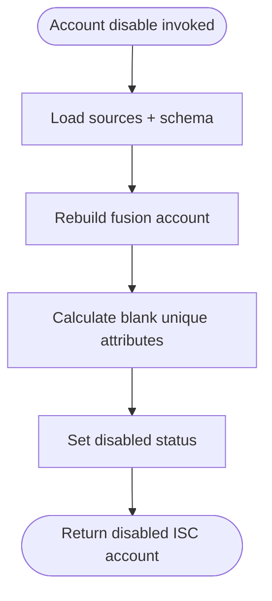

# Account Disable Operation

## Description

The Account Disable operation disables a fusion account. This typically prevents the user from accessing resources linked to this fusion account (conceptual logic, as the actual effect depends on downstream systems).

## Process Flow

## Architecture diagram

1.  **Setup**:
    - Loads sources and schema.

2.  **Fusion Account Rebuild**:
    - Rebuilds the fusion account to ensure we have the latest state before disabling.
    - **Attribute operations** (`ATTR_OPS_REFRESH`):
        - `refreshMapping`: True — re-evaluates attribute mappings from source accounts.
        - `refreshDefinition`: True — re-evaluates Velocity template definitions.
        - `resetDefinition`: False — unique attribute values are preserved.

3.  **Blank unique attributes**:
    - Blank Unique attributes are calculated before the account is disabled.
    - Populated Unique values are preserved. This is not a unique reset.
    - Disable does not fetch or pre-process all Fusion accounts, so collision checks for a newly calculated value are limited to values already registered on this account.

4.  **Disable**:
    - Sets the account's status to disabled.

5.  **Output Generation**:
    - Returns the updated, disabled ISC account.

## Behavior Notes

- **Unique attributes are NOT reset on disable**: The disable operation uses `resetDefinition: false`, so existing unique attribute values (e.g. usernames) are preserved. Blank Unique attributes are calculated. The actual unique attribute reset happens on the subsequent **enable** operation, which sets `resetDefinition: true` to regenerate collision-free values.
- **nativeIdentity and name are preserved**: The `nativeIdentity` and account `name` are never changed by any operation after creation.

