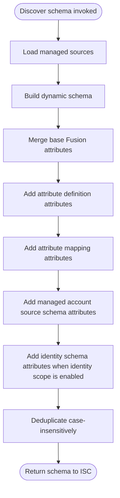

# Account Discover Schema Operation

## Description

The Account Discover Schema operation generates the schema definition for fusion accounts. The schema is dynamic, meaning it is built programmatically based on the configuration and the aggregate schemas of all managed sources.

## Process Flow

## Architecture diagram

1.  **Setup**:
    - Loads all managed sources to access their schemas.

2.  **Schema Build**:
    - Calls `schemas.buildDynamicSchema()`.
    - Combines attributes in a fixed precedence order: the base fusion attributes (identity, name, statuses, actions, accounts, etc.), then attribute definitions, then attribute mappings, then managed account source schemas, then identity schema attributes when identity scope is enabled.
    - Deduplicates attribute names case-insensitively (ISC treats names as case-insensitive). When the same logical attribute appears with different casing (e.g. `FirstName` and `firstname`), the **first** variant in merge order is kept, so an earlier source wins a collision: a definition outranks a mapping, both outrank a managed source attribute, and a managed source attribute outranks an identity schema attribute. Reverse-correlation attributes are appended last.

3.  **Output**:
    - Returns the generated schema object to ISC.

